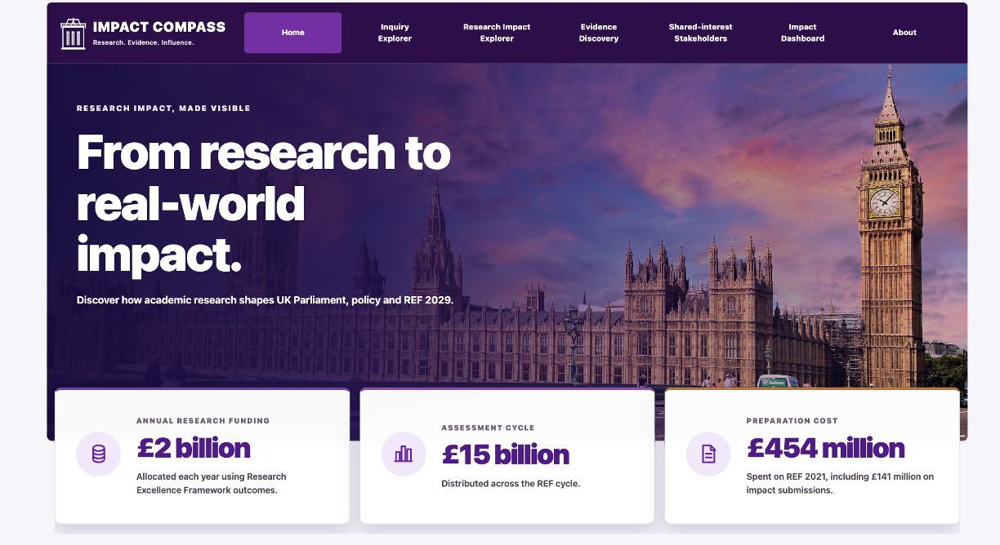
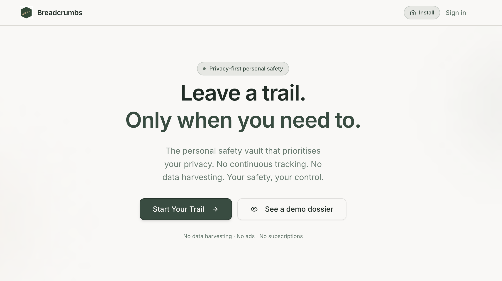

# Hi, I'm Joanne Stocks 👋

### Research Scientist | Data Scientist | AI Practitioner

I build systems that help people discover, understand, and act on information.

My background spans health research, biomedical data science, evidence synthesis, and knowledge translation. More recently, I have focused on machine learning, generative AI, retrieval systems, and human-centred decision-support tools.

I am particularly interested in how AI can help people navigate complex evidence, make better decisions, and translate knowledge into real-world impact.

---

## Featured Projects

<table>
<tr>
<td width="50%" align="center">

### 🧭 Impact Compass

AI-powered research-to-policy discovery platform exploring how retrieval systems, semantic search, and large language models can help connect academic evidence with policy and societal impact.

</td>

<td width="50%" align="center">

### 🍞 Breadcrumbs

Privacy-first digital check-in system that creates temporary evidence trails and only releases information when a user fails to return as expected.

</td>
</tr>
</table>

---

## Featured Repository

### 🧭 impact-compass-open

Public documentation and technical architecture for Impact Compass, an AI-powered research-to-policy discovery platform.

The repository explores how retrieval systems, semantic search, large language models, and structured evidence retrieval can support research impact, policy engagement, and knowledge discovery.

**Topics**

- Retrieval-Augmented Generation (RAG)
- Semantic Search
- Knowledge Discovery
- Policy Intelligence
- Research Impact
- AI Evaluation
- Human-Centred AI

🔗 Repository:

https://github.com/JoanneStocks/impact-compass-open

---

## Open Source Roadmap

### Impact Compass

The public repository currently focuses on architecture, technical documentation, and implementation approaches.

The live platform continues to evolve through ongoing evaluation, experimentation, and user feedback.
The full production platform remains private while evaluation and user testing are ongoing. 

### Breadcrumbs

Breadcrumbs is an active development project exploring privacy-first digital check-ins, structured evidence collection, and AI-assisted context capture.

The long-term aim is to make self-hosted deployment possible so individuals and organisations can operate Breadcrumbs under their own control.

---

## Current Interests

- Human-Centred AI
- AI Evaluation & Safety
- Retrieval-Augmented Generation
- Agentic Systems
- Knowledge Discovery
- Evidence Synthesis
- Research Impact
- Policy Translation
- Health Data Science

---

## Technical Toolkit

**Languages**

Python • R • SQL • Stata • TypeScript

**AI & Data Science**

Machine Learning • NLP • Generative AI • RAG • Semantic Search • Vector Retrieval • LLM Evaluation • Forecasting

**Development**

FastAPI • React • ChromaDB • APIs • Git

---

## Projects & Portfolio

🔬 Academic Research  
https://joannestocks.com

📊 Data Science Portfolio  
https://data.joannestocks.com/data-science

---

## Professional Development

### University of Cambridge

Career Accelerator in Data Science, Machine Learning & AI

### Credentials & Certifications

https://www.credly.com/users/joannestocks/badges/credly

---

### Current Focus

Building AI systems that help people connect evidence with action, improve decision-making, and navigate complex information.
